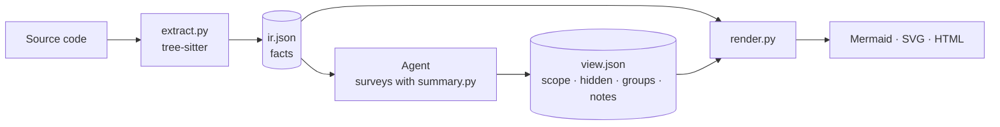

<!-- README-KO.md is its Korean translation; change both together. -->

<div align="center">

<h1 align="center">
  <picture>
    <source media="(prefers-color-scheme: dark)" srcset="assets/logo/draftsman-horizontal-reversed.svg">
    
  </picture>
</h1>

**UML class diagrams for Claude Code and Codex, drawn from parser facts — never from guesses**

[](LICENSE)
[](pyproject.toml)
[](#languages-and-outputs)
[](#install)

[How it works](#how-it-works) · [Install](#install) · [Use](#use) ·
[Tested on real projects](#tested-on-real-projects) · [What it doesn't do](#what-it-doesnt-do) ·
[What's inside](#whats-inside) · [Korean](README-KO.md)

</div>

A **draftsman** takes measured figures and turns them into a drawing without changing a
number. Draftsman is a skill that splits the work the same way: a parser measures the code,
the agent only decides what to show, and a renderer draws it.

- **Facts from a parser** — classes, members, inheritance, field associations with
  multiplicity, and signature dependencies, each with a source location.
- **Edited, not invented** — the agent can hide, group and annotate. A relation the parser
  did not find can only be added as an *inferred* edge with a rationale, drawn dotted.
- **Readable at any size** — focus on one class and its neighbours *N* hops away; hide
  getters, DTOs and framework noise by pattern.
- **Three outputs** — Mermaid for docs and PRs, a static SVG, or a single-file interactive
  HTML viewer with search, focus/hop controls, cycle highlighting and the agent's notes.

<p align="center">
  
</p>

## How it works



The extractor writes what the code says to `ir.json`: types, members, relations, and the
names it could not resolve. The agent never edits that file and never writes diagram text.
It surveys the facts, then writes `view.json` — which class to centre on, how many hops,
what to hide, how to group, what to point out. `render.py` merges the two and refuses any
relation that is not in `ir.json`, unless the view marks it as inferred with a reason.

A request goes through the same steps every time: extract, survey, choose the scope
(everything up to ~30 types, otherwise a focus class and its neighbours), write the view,
render, validate Mermaid, and answer with the diagram, the scope it chose, and the
unresolved references.

## Install

The repository is a plugin and a marketplace for both agents.

**Claude Code**

```text
/plugin marketplace add devgyurak/draftsman
/plugin install draftsman@draftsman
```

**Codex** (the CLI, IDE extension and app share one plugin store)

```bash
codex plugin marketplace add devgyurak/draftsman
codex plugin add draftsman@draftsman
```

Or run `/plugins` inside Codex and pick *Draftsman*.

**The skill alone** — without the plugin's `/draftsman` command:

| Agent | Install |
|---|---|
| Codex | `$skill-installer install https://github.com/devgyurak/draftsman/tree/main/skills/draftsman` |
| Claude Code and other agents that read the Agent Skills format | copy `skills/draftsman/` into the agent's skills directory as is |

**Requirements** — Python 3.10+ with three packages, which the skill installs on first use
if they are missing:

```bash
pip install "tree-sitter>=0.25" tree-sitter-language-pack pyyaml
```

SVG output and the Mermaid syntax check also need Node.js:
`npm ci --prefix skills/draftsman/scripts` (elkjs, mermaid and jsdom at the versions in
`package-lock.json`). HTML output works without it; the viewer then loads the same elkjs
version from a CDN.

## Use

Ask in plain words — the skill picks up requests for class diagrams, structure, inheritance
or dependencies between classes:

> *"Draw a class diagram of this repo."*
> *"Show the classes around OrderService as an interactive diagram."*
> *"클래스 다이어그램 그려줘"*

Or call it directly:

```text
/draftsman [ClassName | path] [mermaid|svg|html] [members|public|no-members]   # Claude Code
$draftsman:draftsman                # Codex (plugin); $draftsman for a skill-only install
```

The output follows the purpose unless you name it: Mermaid for documentation, PRs and chat
answers; the HTML viewer to explore, or for more than about 50 classes; SVG for an image to
embed or put on a slide. The diagram above is
[`tests/fixtures/java/shop`](tests/fixtures/java/shop) rendered with
[`docs/images/example-shop.view.json`](docs/images/example-shop.view.json).

### The view

A view selects and annotates; every key is optional
([all keys](skills/draftsman/references/view-schema.md)):

```json
{
  "focus": "OrderService",
  "hops": 2,
  "hidden": ["*#get*", "*#set*", "*#toString"],
  "notes": [{"target": "Order", "text": "Bidirectional with Customer"}]
}
```

Member detail can differ per class — `"members": {"*": "none", "OrderService": "all"}`
draws the focus in full and only names around it; `--members all|public|none` overrides the
view for one render.

### The scripts on their own

```bash
cd skills/draftsman
python3 scripts/extract.py path/to/src -o ir.json --exclude '**/test/**'   # *.gradle.kts are skipped
python3 scripts/summary.py ir.json                  # sizes, hubs, unresolved references
python3 scripts/summary.py ir.json --type Order     # one type in detail
python3 scripts/render.py ir.json view.json -o diagram.mmd     # or --format svg | html
python3 scripts/render.py ir.json view.json --format svg --members none -o bare.svg
scripts/validate.sh diagram.mmd
```

## Languages and outputs

| Works today | Not yet |
|---|---|
| Extraction for Java, C#, Kotlin, TypeScript/TSX, Python and C++ | Diff mode (changed classes between two commits) |
| Mermaid (syntax-checked), static SVG (ELK layout), interactive HTML | PlantUML output, Graphviz layout |
| Focus + hops, hidden patterns, groups, notes, highlights, inferred edges, cycles | An MCP server, an LSP-backed precise mode |
| Claude Code plugin with `/draftsman`; Codex plugin with `$draftsman:draftsman` | Go and Rust (implicit interfaces and scattered `impl` blocks: out of scope by design) |

Known gaps per language are listed in
[`lang-notes.md`](skills/draftsman/references/lang-notes.md).

## Tested on real projects

Each language was run end to end — extract, then render a focused Mermaid diagram (syntax
checked), an SVG and an HTML viewer — on real projects, tests and generated code excluded:

| Language | Project | Files | Types | Relations | Unresolved | Parse diagnostics |
|---|---|---:|---:|---:|---:|---:|
| Java | [spring-petclinic](docs/e2e/java/spring-petclinic.md) | 30 | 25 | 73 | 0 | 0 |
| Java | [jsoup](docs/e2e/java/jsoup.md) | 105 | 230 | 1310 | 2 (2 outside) | 0 |
| Java | [Netty](docs/e2e/java/netty.md) | 2076 | 2752 | 17600 | 6 (5 outside, 1 unexplained) | 0 |
| C# | [eShopOnWeb](docs/e2e/csharp/eshoponweb.md) `src/` | 209 | 208 | 356 | 199 (1 ambiguous, 198 outside) | 0 |
| C# | [eShop](docs/e2e/csharp/eshop.md) `src/` | 497 | 506 | 924 | 525 (7 ambiguous, 514 outside, 4 unexplained) | 0 |
| C# | [Serilog](docs/e2e/csharp/serilog.md) `src/Serilog` | 113 | 119 | 560 | 23 (23 outside) | 0 |
| Kotlin | [nowinandroid](docs/e2e/kotlin/nowinandroid.md) | 226 | 237 | 388 | 4 (3 outside, 1 unexplained) | 0 |
| Kotlin | [Ktor](docs/e2e/kotlin/ktor.md) | 1578 | 2137 | 6451 | 541 (49 ambiguous, 492 outside) | 0 |
| TypeScript | [nest](docs/e2e/typescript/nest.md) `packages/` | 730 | 738 | 2304 | 0 | 0 |
| TypeScript | [TypeORM](docs/e2e/typescript/typeorm.md) `packages/typeorm/src` | 496 | 694 | 3968 | 1 (1 unexplained) | 0 |
| Python | [httpx](docs/e2e/python/httpx.md) | 23 | 87 | 283 | 0 | 0 |
| Python | [Django](docs/e2e/python/django.md) `django/` | 879 | 1964 | 1853 | 0 | 0 |
| C++ | [leveldb](docs/e2e/cpp/leveldb.md) | 102 | 161 | 885 | 2 (2 unexplained) | 9 spans in 8 files (5 in function bodies; `extern "C"`, `__has_include`, a gMock macro, a pointer-to-member field) |
| C++ | [POCO](docs/e2e/cpp/poco.md) | 2317 | 2066 | 9983 | 309 (1 ambiguous, 4 outside, 304 unexplained; system and library headers, POCO's `#define` types) | 333 spans in 121 files (`#if` branches, pointers to members, explicit instantiations, `typeid`) |

Unresolved references are split by reason: *ambiguous* (a project type shares the name; it is
listed, not picked), *outside* (only something outside the sources could provide it: a
wildcard or default import, a nested type of an external supertype), *unexplained* (neither).
Each project has a page under [`docs/e2e/`](docs/e2e/README.md) with the pinned commit,
the exact commands, and what every unresolved name and diagnostic is.

## What it doesn't do

- **It doesn't guess relations.** Anything not in `ir.json` is rejected unless it is an
  inferred edge between known or unresolved names — and those are drawn dotted.
- **It doesn't read method bodies.** Relations come from supertype clauses, field types and
  signatures. It is not a call graph or a sequence diagram tool.
- **It doesn't tell composition from aggregation** — syntax cannot — except C++ ownership
  (values and `unique_ptr` versus pointers, references and `shared_ptr`).
- **It doesn't run or upload your code.** Everything runs locally; the only network use is
  installing the dependencies above (and the CDN fallback of the HTML viewer).

## What's inside

```text
skills/draftsman/
├── SKILL.md            workflow, hard rules, how scope and output are chosen
├── agents/openai.yaml  Codex display name and default prompt
├── queries/            one tree-sitter query per language: what to capture
├── scripts/            extract.py · summary.py · render.py · validate.sh · layout.mjs
│   └── draftsman/      the library: extractor, resolver, scene, renderers, langs/
├── assets/             draw.js (shared by SVG and the viewer) · viewer.html
├── config/             wrappers.yaml: containers to see through (List<T> → T, *)
└── references/         schemas and language notes, loaded on demand
.claude-plugin/         Claude Code plugin and marketplace manifests
.codex-plugin/ · .agents/   Codex plugin manifest and marketplace
commands/               the /draftsman slash command (Claude Code)
```

| Document | What is in it |
|---|---|
| [`SKILL.md`](skills/draftsman/SKILL.md) | The agent's workflow, hard rules, and how it picks scope and output |
| [`ir-schema.md`](skills/draftsman/references/ir-schema.md) | Every field of `ir.json` and how each relation is derived |
| [`view-schema.md`](skills/draftsman/references/view-schema.md) | Every key of `view.json`, the three outputs, an example |
| [`lang-notes.md`](skills/draftsman/references/lang-notes.md) | Per-language behaviour and known gaps |
| [`query-protocol.md`](skills/draftsman/references/query-protocol.md) | The capture names a language query uses; adding a language |
| [`docs/DESIGN.md`](docs/DESIGN.md) | Design notes (Korean): background, principles, architecture, roadmap |
| [`docs/e2e/`](docs/e2e/README.md) | One page per measured project: pinned commit, commands, results, every unresolved name and diagnostic explained |
| [`CHANGELOG.md`](CHANGELOG.md) | Changes that affect existing `ir.json`/`view.json` files |
| [`assets/logo/GUIDELINES.md`](assets/logo/GUIDELINES.md) | Logo files, colours, clear space, minimum sizes |

## Development and contributing

**Prerequisites** — [uv](https://docs.astral.sh/uv/); Node.js for the SVG and Mermaid tests.

```bash
uv sync                                         # Python dependencies
npm ci --prefix skills/draftsman/scripts   # optional: ELK layout + Mermaid check
uv run pytest                                   # includes node tests of draw.js and the viewer;
                                                # they skip without node
```

The tests live in `tests/`, with the same `shop` fixture in all six languages. A language is
a tree-sitter query plus a small spec: write `queries/<lang>.scm` following the
[capture protocol](skills/draftsman/references/query-protocol.md), add a `LanguageSpec` in
`scripts/draftsman/langs/`, and mirror the `shop` fixture under `tests/fixtures/<lang>/`.

Issues and pull requests are welcome — bug reports from real projects most of all. Read
[`CONTRIBUTING.md`](CONTRIBUTING.md) first: the never-invent rule, where a change goes, how
fixes are tested, and when to re-run the [end-to-end projects](docs/e2e/README.md).

## License

[Apache License 2.0](LICENSE). Third-party components are installed by the user, not
bundled; see [`NOTICE`](NOTICE).
